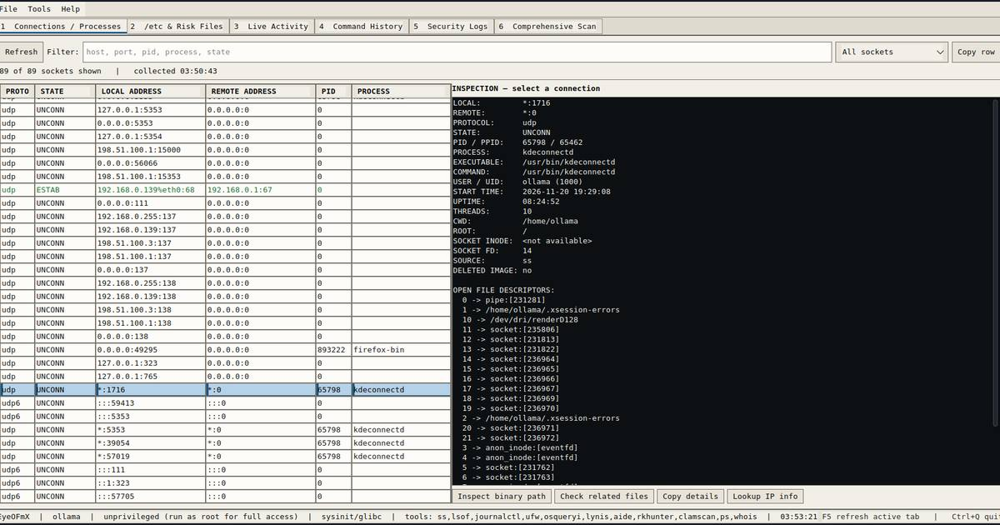

# EyeOFmX
I made this project some time ago, and I am publishing it now with
updates, fixes, and ready-made installers.

EyeOFmX is a native Linux desktop app for looking at system activity and security
posture. It is a normal GTK 3 window, not a browser app. It shows active sockets, the
processes that own them, important `/etc` files, live changes, shell command
history, security logs, and a short posture report. The report collects rootkit,
malware, file-integrity, hardening, and native checks in one place so you get a
quick idea of the machine state without reading many separate tool logs.

The inspection parts only read the system. If optional scanning tools are
missing, the app can offer to install them, but only after you say yes and your
system asks for root authentication.

## Download and install

Do not build anything if you just want to use it. Download the right file from
the Releases page:

https://github.com/zenobiatranoss/EyeOFmX/releases

You can also use the simple download page:

https://zenobiatranoss.github.io/EyeOFmX/

Pick the file for Debian/Ubuntu, Fedora/RHEL, openSUSE, Arch, Alpine, or the
generic Linux tarball. Install it with the usual command for your distribution:

```
sudo apt install ./eyeofmx_1.0.1_amd64.deb
sudo dnf install ./eyeofmx-1.0.1-1.x86_64.rpm
sudo zypper install ./eyeofmx-1.0.1-1.x86_64.rpm
sudo pacman -U ./eyeofmx-1.0.1-1-x86_64.pkg.tar.zst
sudo apk add --allow-untrusted ./eyeofmx-1.0.1-r0-x86_64.apk
```

For the generic tarball, extract it and copy the binary:

```
tar -xzf eyeofmx-1.0.1-x86_64.tar.gz
cd eyeofmx-1.0.1-x86_64
sudo install -m755 eyeofmx /usr/local/bin/
```

## Run

Open EyeOFmX from the applications menu, or run:

```
eyeofmx
```

It works without root, but some process, `/etc`, and log details will be hidden.
Run it with root when you need full visibility:

```
sudo eyeofmx
```

Useful command-line options:

```
eyeofmx -check        # show privileges, kernel, libc, and detected tools
eyeofmx -setup-plan   # show which scanning tools can be installed
eyeofmx -scan         # quick posture report in the terminal
eyeofmx -scan-full    # full posture report in the terminal
```

If scanning tools such as rkhunter, chkrootkit, lynis, aide, ClamAV, or osquery
are missing, EyeOFmX can install the right packages for your distribution. It
first shows the exact command and asks for confirmation. It then uses the
system authentication dialog when possible. After a successful install, it can
restart itself as root and run the full scan. Nothing is installed if you
decline.

## Build from source

You only need this if you want to compile the app yourself. You need Go, cgo, a
C compiler, `pkg-config`, and GTK 3 development files.

```
go mod download
make check
make build
```

The binary is written as `./eyeofmx`. The build uses the `gtk_3_20` tag and
runs against GTK 3.24 or newer.

## License

MIT.
